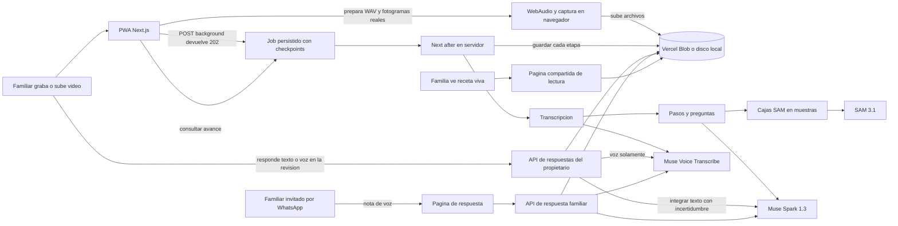

# Arquitectura actual — 28 de octubre de 2026

Regla: cada paso enlaza su clip; las medidas se muestran, nunca se inventan.

`after()` permite continuar tras responder al navegador, pero no sustituye una cola durable y está limitado por la duración de la función. Supabase, worker Python/FFmpeg y tracking temporal de máscaras son partes del plan aún no integradas en la aplicación actual. Ver `REVISION_FLUJO_20261028.md`.
